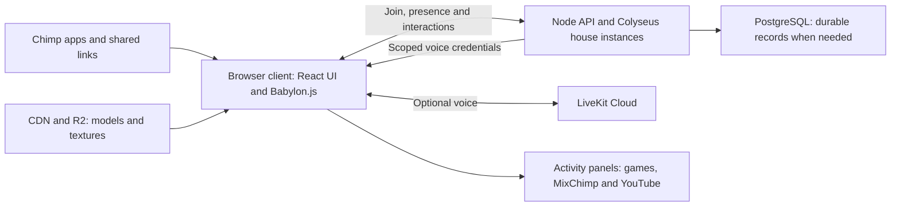

# ChimpVerse technology stack research

Research date: 2026-10-01, America/New_York.

Status: recommendation for discussion and a validation spike. This research does not approve a product decision or establish production capacity.

Storage: repository research. No configured Notion Research Notes destination or tracker was found for this project. This file is not a Notion-authoritative mirror. If a canonical destination is configured later, publish and reconcile this research there before declaring a mirror.

## Recommendation

Start ChimpVerse in desktop browsers, with a normal HTTPS link as its entry point. Use TypeScript and a React DOM interface around a Babylon.js 3D client, Colyseus for authoritative multiplayer room state, and LiveKit for voice. Make WebGL2 the required graphics baseline, and introduce WebGPU after the same scene passes compatibility and performance checks. Build a small optimized part of ChimpHouse before committing to a renderer or producing the full jungle.

This recommendation follows the user's priorities: visitors should join easily, accessibility matters, and good performance matters more than making installation a prerequisite. The confirmed launch scope is desktop browsers, with phones later. A desktop app is a contingency if measurements identify a specific benefit. Installing a web wrapper by itself is not evidence of better rendering performance. The browser path should continue to serve shared links.

Babylon.js is the preferred starting engine because its existing rendering, asset, animation, collision, and inspection features fit a walkable social clubhouse. This is an engineering judgment, not a documented performance advantage over the alternatives. PlayCanvas is the closest alternative if a collaborative visual scene editor is a central part of the production workflow. Three.js with React Three Fiber is a reasonable choice when the team strongly prefers React scene composition and accepts selecting and integrating more game systems.

## Proposed stack

Every row is a recommendation for the spike. Hosting products and package versions remain subject to cost and behavioral validation.

| Responsibility | Initial choice | Reason and boundary |
| --- | --- | --- |
| Browser application | TypeScript, React DOM, Vite | Keep forms, room navigation, chat, settings, moderation and app panels in the DOM. React is a choice for the new client, not a requirement inherited from ChimpVibe |
| 3D scene | Babylon.js, WebGL2 first | One engine for scene assets, animation, character collision and inspection. Measure optional WebGPU separately |
| Asset authoring | Editable Blender/DCC source, glTF/GLB, KTX2 textures, room manifest | Content must meet loading and frame-time budgets independently of the engine |
| Character movement | Capsule controller and simplified house collision, Babylon/Havok integration | Validate stairs, lift, bridge and spawn points. Keep remote characters interpolated visuals initially |
| Shared room state | Colyseus TypeScript server | Authoritative positions, room membership, roles, activity state and media commands |
| Voice | Managed LiveKit Cloud pilot, Web Audio spatial output | Separate audio transport from room state, with custom room/zone subscription policy |
| Hosting | Static client on an owned HTTPS origin/CDN, Cloudflare R2 for versioned assets, Colyseus Cloud pilot | Keep the real-time room server on infrastructure designed for persistent connections. A managed long-running Node container is the alternative |
| Persistent records | Optional managed PostgreSQL, provider chosen after integration review | Add when durable profiles, moderation decisions, projects and event metadata require it. Ordinary movement updates stay in room memory |
| Chimp app integration | Explicit catalogue/identity adapters, dedicated permitted play pages, ordinary HTTPS links | Reuse existing products and keep credentials and application lifecycles scoped |
| Installation | Optional PWA once browser joining is reliable. Tauri or a native engine after a measured need | Returning visitors can install an app icon without making installation a launch prerequisite |

Colyseus Cloud is a documented managed hosting option. Choosing it and LiveKit Cloud for a pilot reduces the initial operations scope, but this research does not establish their cost at the eventual event scale. Pin compatible, tested package versions when implementation starts. The Colyseus documentation currently shows a v0.18 banner, which alone does not prove a particular npm release is stable. [Colyseus Cloud](https://docs.colyseus.io/cloud), [Colyseus documentation](https://docs.colyseus.io/state).

R2 supports asset delivery through a custom domain with Cloudflare caching, while `r2.dev` is a development endpoint. Configure the asset domain, CORS, cache rules and immutable versioned paths as part of the deployment. A self-managed Colyseus deployment needs its documented proxy/process setup. Self-hosting LiveKit adds networking, public IP, UDP/TURN and TLS work. Managed hosting is proposed for the pilot because those operations are outside the first scene experiment. [R2 public buckets](https://developers.cloudflare.com/r2/buckets/public-buckets/), [Colyseus deployment](https://docs.colyseus.io/deployment), [LiveKit deployment](https://docs.livekit.io/transport/self-hosting/deployment/).

### Proposed system boundaries

The visitor's device renders the house. The room server runs shared rules and presence, while LiveKit transports voice. Existing activity applications retain their own backends.

## Requirements shaping the choice

The local [ChimpHouse description](../../chimphouse-description.md) calls for two occupied levels, an atrium visible from both floors, curved rooms and glazing, jungle views, an upper bridge arrival, a lift, chimp avatars, and multiple social activities. The concept images define the intended atmosphere and room relationships. Exact dimensions, meshes, collision surfaces, and final 3D geometry are still unset.

The house should be one coherent place, but its activities need separate execution boundaries. Walking, avatar presence, conversation, and shared room state belong in ChimpVerse. Arcade games, MixChimp tools and project demonstrations should initially reuse their browser applications through deliberate links or permitted panels. The proposed trading simulator can use a focused HTML chart. Rebuilding activity interfaces inside the renderer is a separate scope decision.

No engine documentation establishes how many visitors this particular scene can support or whether it can reproduce the reference images at a specific frame rate. Those answers depend on assets, device tier, avatar count, media activity, network topology, and measured implementation.

## Joining, links and installation

Use an owned canonical HTTPS route such as `https://<chosen-ChimpVerse-host>/house/chimphouse?spawn=mixchimp`. This is an illustrative route, not an existing deployment. Arcade, MixChimp, the showroom and other Chimp apps can provide ordinary links to it. The target spawn selects an arrival location after the server validates the destination and room access.

| Step | Proposed visitor experience | Required application behavior |
| --- | --- | --- |
| 1 | Open a shared or Chimp app link | Show a small usable DOM page before loading the full scene. Preserve the requested house and activity |
| 2 | Enter a nickname and select Join | Offer guest entry with a shared default chimp. Persist an optional local preference. Do not make account creation or avatar customization a first-visit gate |
| 3 | Reach the requested house instance | Server validates access, chooses the room instance and safe spawn, and issues short-lived scoped credentials |
| 4 | Begin moving or use the room list | Start in a safe visible location. Keep room navigation, text and activity links usable during scene loading or graphics failure |
| 5 | Optionally enable voice | Explain the microphone control and request permission from a deliberate action. Mic denial still leaves a usable social/text experience |
| 6 | Open an activity | Release movement focus, show an accessible application/player panel or open the original application, and preserve a clear return route |

Define whether a link targets a particular event instance or a general house. Friends joining the same link need stable routing, and a full instance needs a visible queue or alternate instance choice. These are custom application behaviors, not effects automatically supplied by the renderer.

A PWA can add a home-screen/app icon and a standalone window when supported. Install UI and URL capture differ between browsers and platforms, so a shared link cannot be promised to automatically open an installed PWA everywhere. Cached assets can improve repeat joins, while live multiplayer still needs the network. [PWA installability](https://developer.mozilla.org/en-US/docs/Web/Progressive_web_apps/Guides/Making_PWAs_installable), [Standalone PWA behavior](https://developer.mozilla.org/en-US/docs/Web/Progressive_web_apps/How_to/Create_a_standalone_app).

If a desktop wrapper becomes justified, Tauri supports desktop custom-scheme deep links and single-instance handling. Keep the HTTPS landing page and offer an explicit Open app action with browser fallback. Tauri's Windows installer can bootstrap the WebView2 runtime, while offline/fixed-runtime distribution adds payload. Signed updates require an update pipeline. This does not establish a universally tiny installation or a frame-rate improvement for the same web scene. [Tauri deep links](https://v2.tauri.app/plugin/deep-linking/), [Windows distribution](https://v2.tauri.app/distribute/windows-installer/), [Signed updater](https://v2.tauri.app/plugin/updater/).

Electron instead distributes Chromium, Node.js and V8 with the app. That provides a controlled browser runtime but brings its runtime distribution and update responsibilities. Neither wrapper demonstrates a specific download size or better scene performance without a real build and measurements. [Why Electron](https://www.electronjs.org/docs/latest/why-electron).

Cloud rendering is another route to a browser link. Unreal Pixel Streaming renders and encodes the scene on a server and streams it to the browser, and independently controlled sessions can require multiple engine instances. Inference: it moves scene rendering away from the visitor's device, while adding server GPU operations, bandwidth and input round-trip concerns. It is a contingency if the required visuals fail local browser budgets, rather than the recommended first pilot. No per-user GPU count or cost is established here. [Pixel Streaming](https://dev.epicgames.com/documentation/en-us/unreal-engine/pixel-streaming-in-unreal-engine), [Pixel Streaming hosting](https://dev.epicgames.com/documentation/en-us/unreal-engine/hosting-and-networking-guide-for-pixel-streaming-in-unreal-engine).

## Multiplayer and voice

Colyseus synchronizes server-owned state through property-level delta patches. Clients request changes with messages rather than directly changing authoritative state. Its reconnect flow can reserve a seat and let the SDK retry, but that should not be treated as recovery from a crashed room process. A room belongs to one process, so adding processes supplies capacity for more rooms rather than automatically distributing one room's simulation. [Colyseus state synchronization](https://docs.colyseus.io/state), [Reconnection](https://docs.colyseus.io/room/reconnection), [Scaling](https://docs.colyseus.io/scalability).

Proposed room state includes identity, validated position/orientation, animation intent, current activity, presence, host/moderator roles, theatre playback metadata and simulated market state. Use client interpolation and restrained position updates for visual smoothness. Validate movement bounds, interaction eligibility and command rates server-side. Authority is an application rule that must be implemented, not a consequence of forwarding arbitrary client positions through Colyseus.

Start with independent ChimpHouse instances and an empirically chosen participant cap. Define reconnect grace, restoration after process restart, and persistence separately. Broad events can use multiple house instances with shared host/media metadata instead of attempting one unlimited simulation. The room cap, tick rate and event policy remain unresolved until tests and costs are known.

Nakama is a credible alternative if the product needs its broader built-in friends, groups, leaderboards and storage capabilities. It supports both authoritative and relayed multiplayer modes. Colyseus is preferred here for the narrower custom TypeScript room server and app adapters, which is a scope judgment rather than a measured performance win. [Nakama multiplayer modes](https://heroiclabs.com/docs/nakama/concepts/multiplayer/), [Nakama capabilities](https://heroiclabs.com/nakama/index.html).

LiveKit can disable automatic subscriptions, select tracks from the client, and update subscriptions from the server. Its room/participant grants scope connection and publishing capabilities. These building blocks support spatial voice, but proximity, walls, floor separation and private groups require a custom policy. [LiveKit subscriptions](https://docs.livekit.io/transport/media/subscribe/), [Tokens and grants](https://docs.livekit.io/frontends/reference/tokens-grants/).

The proposed pilot uses one voice room per house instance, selective audio subscriptions, and a distance/zone policy based on server-validated positions. Use separate host broadcast behavior for theatre and event sessions. Gain and panning can follow the listener and speaker positions through Web Audio spatial nodes. [Web Audio PannerNode](https://developer.mozilla.org/en-US/docs/Web/API/PannerNode).

Client-only volume reduction is an audio presentation choice, not privacy enforcement. If a room promises private conversation, authorized subscriptions must be enforced on the server and tested. Voice starts off. Provide mute, push-to-talk or explicit mic toggling, output selection where supported, user block/report, host moderation and a visible speaking state. Phone touch controls come later, but microphone and navigation APIs should not depend on a desktop-only key binding.

## ChimpVibe and room activities

The inspected local ChimpVibe site uses a Node HTTP server and browser ES modules. It does not establish a React or Next.js requirement for ChimpVerse. Its current signup flow returns an MCP member bearer used in client setup instructions, not a cross-app browser SSO session. These are source observations, not verification of the live deployed configuration. [Site server](/Users/jdholst/Git/ChimpVibe/site/server.mjs:1), [Browser signup module](/Users/jdholst/Git/ChimpVibe/site/public/join.js:1), [Token creation](/Users/jdholst/Git/ChimpVibe/site/server.mjs:701), [Client setup uses](/Users/jdholst/Git/ChimpVibe/site/public/join.js:64).

Propose a separate ChimpVerse guest/browser session and a future server-side identity bridge if persistent shared accounts become a requirement. Never put the MCP bearer in a ChimpVerse join URL or reuse it as a generic game/voice credential. The identity bridge needs an explicit design and acceptance test.

The site already renders playable games with an iframe, but its main-site CSP sets `frame-ancestors 'none'`. Native play transport separately reads `CHIMPVIBE_FRAME_ANCESTORS`. A successful embedding design therefore requires dedicated play pages and explicit authorization for the actual ChimpVerse origin. It cannot assume the whole ChimpVibe site is embeddable. [Game iframe](/Users/jdholst/Git/ChimpVibe/site/server.mjs:130), [Main-site CSP](/Users/jdholst/Git/ChimpVibe/site/server.mjs:101), [Play frame origins](/Users/jdholst/Git/ChimpVibe/site/server.mjs:2548).

Preserve the existing game renderer's sandbox when integrating an arcade panel. Enabling an approved parent origin should not grant community game programs access to the house session, room credentials or other applications. The current renderer response uses a script-only CSP sandbox and restricts its connections. [Renderer isolation](/Users/jdholst/Git/ChimpVibe/play/transport.mjs:208).

| Room | Initial implementation proposal | Qualification needed |
| --- | --- | --- |
| Arcade | Cabinet thumbnails from a catalogue adapter. Open a dedicated permitted play page in a focused DOM panel or the original app | Current catalogue contract, embedding policy, keyboard focus, game lifecycle and return to house |
| Theatre | Official YouTube player in a DOM panel, with shared playback metadata | Video eligibility, autoplay, captions, controls, buffering, ads, mobile behavior later, and host permissions |
| MixChimp | Existing web app in a focused panel or ordinary link, with shared presence and selected-track metadata | Origin policy, browser identity, rights, background audio, collaboration semantics and measured latency |
| Community builds | Screenshots, metadata and links by default. Embed only an allowed app origin | Content moderation, embedding permission, link safety, keyboard access and ownership |
| Trading | Server-generated synthetic ticks and shared simulation clock, with an HTML chart on interaction | Simulation rules, account persistence, rates and explicit simulated-market presentation |

Wrapping an arcade game does not add spectator or multiplayer behavior to that game. Reuse only interfaces the game actually exposes. Likewise, the MixChimp room should not move AI inference or a music production backend into the 3D client merely to make the studio visible.

The YouTube IFrame API exposes playback, seeking, player events, errors and autoplay-blocked behavior. Use the official player with its controls, captions and fullscreen/open-original route. A YouTube iframe should remain a DOM player rather than being captured into a WebGL texture. [YouTube IFrame API](https://developers.google.com/youtube/iframe_api_reference).

YouTube's required minimum functionality includes unobscured player controls, minimum player dimensions and visibility rules for autoplay. The theatre panel must preserve these conditions rather than placing 3D decorations over the player. [YouTube required minimum functionality](https://developers.google.com/youtube/terms/required-minimum-functionality).

Propose synchronizing the selected media, playback intent and server-time reference, with each viewer obtaining the original stream through the official player. Do not distribute YouTube video bytes through the multiplayer server. Prerecorded seeking can be best effort, while buffering, ads and live-stream differences can prevent identical playback. No frame-perfect watch-together guarantee is established by the API. Test source terms and actual embed behavior before publishing the theatre.

## Accessibility and input

Provide a DOM room list, participant list, text chat, activity actions, settings and moderation controls alongside the 3D view. Visitors should be able to reach each activity without steering an avatar. Maintain visible keyboard focus, labeled controls, an escape/close route from each panel, and restoration of focus after activity exit. Keep important content as HTML instead of text visible only on a distant 3D screen.

WCAG 2.2 includes keyboard operation, no keyboard traps, focus visibility, labels/roles and media-related criteria. Use it to define testable interface requirements, then test with keyboard and screen-reader users. This research does not claim the proposed scene or a chosen engine already conforms. [WCAG 2.2](https://www.w3.org/TR/WCAG22/).

Offer reduced camera motion, adjustable sensitivity, accessible room teleport/selection, text participation, readable chat and audio controls. Decide which events require live captions or transcripts and whether the chosen media source supplies them. When voice captions are absent, keep text chat available, without claiming that text chat reproduces every spoken exchange. Headphones, a microphone, pointer lock and fast camera movement should not be required to join. Desktop keyboard/mouse comes first, while input actions, responsive panels and movement choices should allow later touch implementation. No engine selection alone makes a 3D canvas screen-reader accessible.

## Rendering decision matrix

The assessments below are judgments for this project. Documented capabilities are cited separately from the suggested ranking.

| Option | Joining through a browser link | Scene and avatar workflow | Web application integration | Native option | Assessment for ChimpHouse |
| --- | --- | --- | --- | --- | --- |
| Babylon.js | Direct JavaScript client with WebGL and WebGPU backends | Engine provides glTF loading, animation, physics integration, collision controller, LOD and scene inspection | Fits a TypeScript client with ordinary DOM controls and browser SDKs | Possible future native or desktop work, but not needed for the first release | Preferred validation candidate |
| Three.js + React Three Fiber | Direct JavaScript client | Rendering and animation are available. Physics, locomotion, multiplayer and scene conventions need additional choices | Strong fit for a React application. R3F is a React renderer for Three.js | A desktop wrapper can reuse the web client. A native game runtime is a separate choice | Best alternate for a team with existing R3F experience |
| PlayCanvas | Direct JavaScript client, with WebGL2 and optional WebGPU fallback | Entity/component engine, animation and physics systems, browser scene editor and asset workflow | Can be used standalone from npm, or through its React integration | Web builds can be packaged later | Closest complete web-engine alternate, especially for editor-driven production |
| Godot | WebAssembly export can be linked from a website | Full game editor, character and animation tooling, native and web export paths | JavaScript bridge is available. Browser SDK integration introduces an additional boundary | Direct desktop and mobile exports | Strong candidate if native play becomes primary. Its present web audio/export limits increase integration risk here |
| Unity | WebAssembly export can be linked from a website, with desktop and some mobile browser support | Full game editor and established animation, physics, lighting and content tooling | Browser integrations cross the Unity/JavaScript boundary | Desktop, mobile and other targets | Strong candidate for an experienced Unity team or a native-focused product. More platform-specific integration and build work for the current browser priority |

### Babylon.js evidence and tradeoffs

Babylon maintains WebGL and WebGPU support alongside each other. Its WebGPU initialization is asynchronous. The app must select and initialize its graphics backend before building the scene, and handle failure explicitly. The recommendation to qualify WebGL2 first is about reach and test scope, not a claim that WebGPU is slower. [Babylon WebGPU support](https://raw.githubusercontent.com/BabylonJS/Documentation/master/content/setup/support/webGPU.md), [WebGPU initialization source](https://raw.githubusercontent.com/BabylonJS/Babylon.js/master/packages/dev/core/src/Engines/webgpuEngine.pure.ts).

Its glTF loader supports Draco and Meshopt geometry compression and KTX2/Basis textures. Decoder resources default to Babylon CDN downloads, while the official documentation recommends serving production packages and decoder resources from the application's own infrastructure. Use pinned npm packages and locally hosted codecs. [Babylon glTF loader](https://raw.githubusercontent.com/BabylonJS/Documentation/master/content/features/featuresDeepDive/importers/glTF.md).

The physics character controller can use a capsule or a supplied shape and supports collision movement and animated platforms such as lifts. This fits the building's stairs, gallery, doors and lift. It still requires authored collision geometry and locomotion behavior. [Babylon character controller](https://raw.githubusercontent.com/BabylonJS/Documentation/master/content/features/featuresDeepDive/physics/v2/characterController.md). Babylon core is Apache 2.0, and the browser Havok package is MIT. These are separate components with separate notices. [Babylon license](https://github.com/BabylonJS/Babylon.js/blob/master/license.md), [Havok package](https://github.com/BabylonJS/havok/blob/main/packages/havok/package.json).

### Three.js and React Three Fiber evidence and tradeoffs

Three.js `WebGPURenderer` uses WebGPU when supported and automatically falls back to WebGL2. Existing custom `ShaderMaterial`, `RawShaderMaterial`, and `onBeforeCompile` modifications do not transfer directly to this renderer, so renderer choice constrains later material work. [Three.js WebGPU guide](https://threejs.org/manual/pages/webgpurenderer).

The official glTF loader exposes animation clips and supports compressed geometry, KTX2 textures, and GPU instancing extensions. Its animation mixer can play animation for a chosen object. These capabilities cover rendering assets and playing avatar clips, but do not define character locomotion or a multiplayer protocol. [Three.js glTF loader](https://threejs.org/docs/pages/GLTFLoader.html), [Animation mixer](https://threejs.org/docs/pages/AnimationMixer.html).

R3F is a React renderer for Three.js. At the research date its documentation describes v10 with WebGPU support as alpha, while v9 pairs with React 19. If selected, use a supported version pair and qualify the exact renderer integration rather than assuming the next major version is production ready. [R3F introduction](https://r3f.docs.pmnd.rs/). Three.js and R3F use MIT licenses. [Three.js license](https://raw.githubusercontent.com/mrdoob/three.js/dev/LICENSE), [R3F license](https://raw.githubusercontent.com/pmndrs/react-three-fiber/master/LICENSE).

### PlayCanvas evidence and tradeoffs

PlayCanvas supports WebGL2 and WebGPU. Its standalone setup can request WebGPU and fall back to WebGL2. The engine can be used from npm without the hosted Editor. Its engine documentation distinguishes the direct engine workflow from the Editor workflow. [Supported browsers](https://developer.playcanvas.com/user-manual/engine/supported-browsers/), [Standalone engine](https://developer.playcanvas.com/user-manual/engine/standalone/), [Engine workflow](https://developer.playcanvas.com/user-manual/engine/).

The hosted Editor provides visual scene work, but private projects require a premium subscription. Editor builds can be downloaded and hosted on the project's own domain. The runtime engine is MIT. Treat an Editor subscription, hosting, and engine licensing as separate choices. [Project privacy](https://developer.playcanvas.com/user-manual/editor/projects/settings/), [Self-hosting](https://developer.playcanvas.com/user-manual/editor/publishing/web/self-hosting/), [Engine license](https://github.com/playcanvas/engine/blob/main/LICENSE).

Its animation component uses animation state graphs, and its runtime lightmap system can bake static lighting. Runtime baking is a supported feature, not a reason to make every visitor wait for a large lighting bake. For this project, prefer an authored and measured lighting pipeline. [Animation component](https://developer.playcanvas.com/user-manual/animation/anim-component/), [Runtime lightmaps](https://developer.playcanvas.com/user-manual/graphics/lighting/runtime-lightmaps/).

### Godot evidence and tradeoffs

Godot's current stable web export requires WebAssembly and WebGL2, uses only the Compatibility renderer, and does not support WebGPU. Godot 4 C# projects cannot currently export to web. Single-thread export is the default. Enabling threads requires cross-origin isolation headers. Default web Sample audio omits audio effects and procedural audio generation, and the documentation cautions about positional audio behavior. These limitations matter when combining embedded media and music tooling with spatial conversation. [Godot web export](https://docs.godotengine.org/en/stable/tutorials/export/exporting_for_web.html).

Godot is MIT licensed and can export directly for Windows. It also has automated mesh LOD and baked lightmaps. Web can render lightmaps baked on another platform, but the web editor cannot bake them. These are useful native/editor strengths, even though the browser integration issues need a dedicated spike. [Godot license](https://godotengine.org/license/), [Windows export](https://docs.godotengine.org/en/stable/tutorials/export/exporting_for_windows.html), [Mesh LOD](https://docs.godotengine.org/en/stable/tutorials/3d/mesh_lod.html), [Lightmap GI](https://docs.godotengine.org/en/stable/tutorials/3d/global_illumination/using_lightmap_gi.html).

### Unity evidence and tradeoffs

Unity 6 documentation supports desktop browsers with WebGL2 and WebAssembly, and lists iOS Safari 15+ and Android Chrome 58+ for mobile. Describing Unity web as universally unsupported on mobile would therefore be incorrect. Browser support is still distinct from acceptable performance for this scene. [Unity web browser compatibility](https://docs.unity3d.com/6000.0/Documentation/Manual/webgl-browsercompatibility.html).

Unity 6.3 LTS labels its WebGPU path experimental and documents WebGL2 as the default. Its web platform also limits managed C# threads, sockets and audio. That increases the qualification work for voice and music libraries originally designed for native platforms. [Unity 6.3 WebGPU](https://docs.unity3d.com/6000.3/Documentation/Manual/WebGPU.html), [Unity web limitations](https://docs.unity3d.com/6000.0/Documentation/Manual/webgl-technical-overview.html).

Unity is proprietary and has plan eligibility rules. Its current Personal financial threshold is US $200,000 across the most recent twelve months, with the applicable definition of total finances depending on the user's circumstances. The Runtime Fee policy was cancelled. Review the live terms when choosing a plan rather than budgeting from an old pricing summary. [Unity license eligibility](https://unity.com/pages/license-compliance), [Runtime Fee cancellation](https://unity.com/blog/terms-update-runtime-fee-cancellation), [Unity platform plans](https://unity.com/products?c=unity+hub).

## Asset and rendering plan

The following is a proposal for the optimized scene, not an existing asset pipeline or engine guarantee.

1. Establish a measured architectural source model. Preserve the two floors, atrium, room adjacency, trunks, bridge, stairs and lift from the description. Export room groups and collision meshes with consistent units and origins.
2. Author game assets in a DCC tool such as Blender and deliver glTF/GLB plus an explicit manifest for rooms, colliders, lighting and interactive destinations. Keep the editable source assets. Verify the selected exporter and engine agree on materials, UV sets, scale, animation and any baked-lighting metadata.
3. Separate the arrival scene from additional room detail. Initially load the foyer, nearby lounge, low-detail exterior and one shared chimp avatar. Load room equipment and distant jungle sections when needed. A single GLB containing the entire furnished jungle is a poor starting point for measuring first join.
4. Use baked lighting for the static house and limited dynamic lighting for avatars and nearby activity. Author day and night as measured presets using the same geometry. Avoid full real-time global illumination as a baseline requirement. Babylon PBR materials support lightmaps, while baked lighting remains static and needs an explicit export/loading convention. [Babylon PBR material features](https://raw.githubusercontent.com/BabylonJS/Documentation/master/content/features/featuresDeepDive/materials/using/masterPBR.md).
5. Use LOD for trees, furniture, exterior architecture and avatars. Preserve the silhouette and room readability at the lowest tier. Babylon supports distance-based mesh LOD. [Babylon LOD](https://raw.githubusercontent.com/BabylonJS/Documentation/master/content/features/featuresDeepDive/mesh/LOD.md).
6. Share materials and instance repeated foliage and props. Divide foliage into spatial groups. Babylon thin instances are useful for mostly static objects, but each group is culled as a whole, so one batch spanning the entire jungle undermines visibility savings. [Babylon thin instances](https://raw.githubusercontent.com/BabylonJS/Documentation/master/content/features/featuresDeepDive/mesh/copies/thinInstances.md).
7. Use KTX2/Basis for appropriate textures and compare compressed quality in motion. Reducing JPEG/PNG download size alone does not establish a small GPU footprint. Hardware texture compression and mipmaps must be measured separately. [Babylon KTX2](https://raw.githubusercontent.com/BabylonJS/Documentation/master/content/features/featuresDeepDive/materials/using/ktx2Compression.md), [PlayCanvas texture memory explanation](https://developer.playcanvas.com/user-manual/optimization/texture-compression/).
8. Simplify collision shapes independently of visible geometry. Use one local character controller, static architectural collision, and narrowly scoped interactions. Treat other visitors as visual/social entities until pushing, jumping and shared rigid-body play are explicitly required.
9. Start with one rigged chimp, a small shared animation set, and appearance variations that reuse geometry and material resources. Reduce distant animation update cost and measure skeleton, skinning and draw-call cost at each crowd step. Test Yousef's separate host representation before promising custom avatars or imported rigs.
10. Use a simple animated pool material with restrained reflection features. Limit glass layers, transparent foliage overdraw, real-time shadows and post effects. Static room screens should use images until a visitor opens the activity. Only active media should decode video.

The performance risks of dynamic lights, shadow passes, transparency, device pixel ratio and detailed collision meshes are documented by PlayCanvas, and apply as areas to investigate for this proposed scene. They are not predictions of a specific Babylon frame rate. [PlayCanvas optimization guidelines](https://developer.playcanvas.com/user-manual/optimization/guidelines/).

The reference images cannot be treated as ready-to-run 3D content. Their appearance must be translated into geometry, texture, lighting and animation budgets. Acceptance should compare an optimized moving scene on the chosen devices against agreed visual priorities, rather than requiring every reference-image lighting effect at every quality tier.

## Provisional performance targets

These are proposed spike targets. They are not supported capacity claims, acceptance already obtained, or final launch requirements. Select actual minimum devices and network conditions before applying them.

| Metric | Proposed starting target | Measurement condition |
| --- | --- | --- |
| Join interface | Usable within 2 seconds | Cold load, 10 Mbps down, 100 ms RTT, no cached assets |
| First controllable arrival scene | Within 12 seconds | Same network, chosen integrated-GPU laptop, shared default avatar |
| Initial transfer | At most 8 MB compressed, including initial client and essential scene assets | Measure over the network, excluding optional rooms and subsequent video traffic |
| Repeat join | Controllable arrival within 5 seconds | Warm cache, same device and network, no authentication retry |
| Ordinary desktop scene | Median frame time at most 16.7 ms, p95 at most 25 ms | 1080p or capped render resolution, agreed integrated-GPU laptop, ten-minute arrival/room route |
| Desktop low-quality scene | Median frame time at most 33.3 ms, p95 at most 50 ms | Named lower-tier desktop/laptop, low quality, ten-minute route |
| Later phone phase | Establish separate mobile frame-time and payload budgets after the desktop release | Named midrange phones, touch input and thermal behavior. This is not a desktop launch gate |
| Initial scene draw calls | Investigate a budget near 200 in low quality | Record shadows and additional passes separately. Change the budget from evidence |
| Initial avatar capacity test | Steps of 1, 8, 16, 32 and 50 visible animated avatars | Synthetic rendering tests first, then actual clients with voice and media enabled |
| Long-session stability | No crash, context-loss dead end, reconnect loop or sustained memory growth over 30 minutes | Movement across all loaded rooms, theatre activity, repeated arcade opens and reconnects |

Frame time and payload budgets are goals chosen for a useful prototype. Room capacity must be set from the point where the full client, server and voice tests remain acceptable. The crowd test sizes are inputs to the experiment, not a commitment to launch with 50 people per house.

Record render resolution, device/browser version, visible avatars, animation quality, media streams, transferred bytes, draw calls, long tasks, frame-time percentiles and disconnects. Use actual device profiling, not desktop emulation alone. Babylon provides engine and scene instrumentation for draw calls, animation/physics-inclusive frame time, shader compilation and selected GPU measurements. [Babylon instrumentation](https://raw.githubusercontent.com/BabylonJS/Documentation/master/content/features/featuresDeepDive/scene/optimize_your_scene.md). PlayCanvas likewise recommends repeatable scenarios and measured baselines before optimization. [PlayCanvas measurement workflow](https://developer.playcanvas.com/user-manual/optimization/).

## Rendering validation spike

Build one representative vertical slice: lower arrival, atrium view into the gallery, one lounge, nearby jungle, glass, a minimal pool view and a rigged chimp. Use representative materials and lighting, not placeholder cubes alone. Keep the full world unbuilt while this slice tests the decision.

For the desktop launch, test WebGL2 on current Chrome/Edge, Firefox and Safari, with at least one Windows integrated-GPU laptop and an Apple laptop. Add the WebGPU path as a separate run using the same route and quality settings. Record capability and initialization failures, verify WebGL2 recovery, and measure quality differences. Browser versions must be recorded because engine and graphics support can change. iPhone Safari and Android Chrome testing belongs to the later phone phase.

Run the crowd steps above, including all visitors in the atrium, a room transition, and a theatre scenario. Then add real voice and browser media. Video decode, audio and networking compete with rendering for device resources, so the final experiment must include them. A rendering-only benchmark cannot establish a launch room size.

Qualify capsule movement on curved thresholds, stairs, the bridge, the gallery rail, the lift, pool edges, spawn points and reconnect recovery. Test keyboard and click-to-move alternatives, direct room selection, reduced camera motion, and a complete non-3D room view before relying on movement as the only activity route. Preserve an input abstraction suitable for touch, then test and accept touch controls in the phone phase.

Compare Babylon with PlayCanvas or R3F only if the first slice exposes a concrete blocker, a workflow mismatch, or a demonstrated advantage worth the switch. Recreating the full scene in all five engines would consume time without directly resolving the main uncertainties.

## Phased launch proposal

| Phase | Scope | Exit evidence |
| --- | --- | --- |
| 0: decisions and spike | Minimum devices, onboarding flow, accessible room view, measured arrival slice, one avatar, backend/media prototypes | Measured cold/warm join, compatibility failures, frame times, integration feasibility and agreed visual direction |
| 1: private social clubhouse | Desktop arrival, lounge, gallery circulation, presence, text, voice, moderation and simple arcade/app links. Optional PWA after the browser join works | Real visitors can enter, meet, mute/block/report, reconnect, and reach activities with keyboard and pointer controls. Verify PWA installation and cache/version behavior where offered |
| 2: public event venue | Theatre, live catalogue, community showroom, host roles and event room allocation | Media policy compliant playback, crowd and cost tests, load control, event moderation and usable fallback UI |
| 3: creative activity rooms | MixChimp workflows, simulated trading, pool interaction and deeper app handoffs | Separate acceptance tests for collaboration semantics, audio latency, persistence and simulation behavior |
| 4: phone support and optional native distribution | Phone-specific assets/quality, responsive panels and touch input. Desktop/native distribution where justified | Phone compatibility, thermal and input acceptance. Native installers need a defined benefit, reliable URL handoff, signing/update plan and maintained browser entry |

## Major risks and unresolved decisions

- Device scope: "anyone with a link" is an onboarding priority, not a technical guarantee that every device can render the house. Desktop browsers launch first and phones follow later. Decide minimum desktop devices and the non-3D fallback behavior.
- Art production: there are concept references, but no final geometry or measured asset budget. Curved glazing, dense foliage, animated avatars, water and night lighting can dominate rendering cost.
- Avatar scope: choose one shared rig initially. Decide whether users need appearance variations, imported avatars, facial animation, swimming or physics interactions.
- Crowd scope: define ordinary room size, event audience size, and acceptable crowd representation before choosing server limits or promising concurrency.
- Accessibility: decide whether the complete activity experience can operate through a DOM room view, and which content needs captions/transcripts and keyboard equivalents.
- Studio scope: shared listening and collaborative arrangement editing are different requirements from playing instruments together live. Measure and specify the audio behavior before promising simultaneous performance.
- Native scope: identify the problem an installed client should solve and the supported operating systems. Avoid treating installation as an automatic fix for content and network cost.
- Budget and operations: set monthly infrastructure ceilings, regions, moderation ownership, and retention rules after the voice/server experiments provide usage data.
- Final product decisions: approve the exact renderer version, authoring workflow, room cap, guest/account policy and launch phases after the spike evidence is reviewed.

The recommended next engineering action is a measured Babylon.js browser prototype containing the arrival lounge, atrium, one chimp avatar, shared presence, optional voice and one working arcade link.
